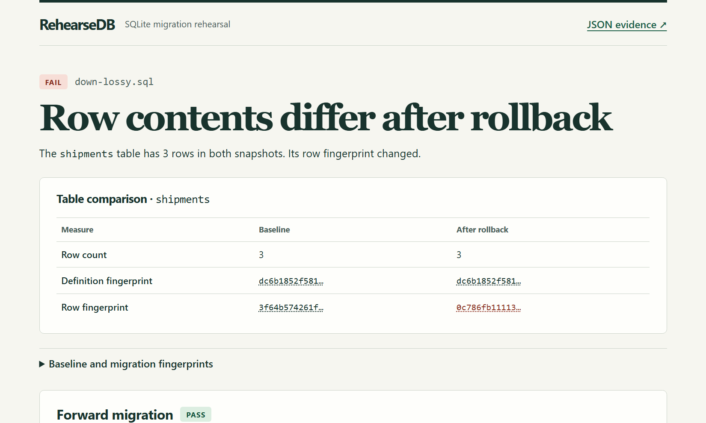

# RehearseDB

A rollback can restore every column and return the right row count while losing the values in those rows. RehearseDB catches that failure before deployment. It runs a forward migration and its rollback on a disposable copy of a SQLite database, then compares the result with the original snapshot.

Use the exit code in CI, open the HTML report during review, or let an agent inspect the same report over [MCP](#inspect-a-report-over-mcp).

## Run the shipping example

To inspect the example immediately, extract `shipping-demo.zip` and open `lossy/report.html` in a browser. To run the migrations yourself, install Java 21 and extract `rehearsedb-0.1.0.zip`. The distribution includes the SQLite JDBC driver, launchers and example migrations. Both archives and their `SHA256SUMS` are on the [release page](https://github.com/Almeida96/rehearsedb/releases/tag/v0.1.0).

**Linux and macOS**

```sh
unzip rehearsedb-0.1.0.zip
chmod +x rehearsedb-0.1.0/bin/rehearsedb
export PATH="$PWD/rehearsedb-0.1.0/bin:$PATH"
rehearsedb demo --out shipping-demo
```

**Windows PowerShell**

```powershell
Expand-Archive .\rehearsedb-0.1.0.zip -DestinationPath .
$env:Path = "$(Resolve-Path .\rehearsedb-0.1.0\bin);$env:Path"
rehearsedb.bat demo --out shipping-demo
```

Open `shipping-demo/lossy/report.html`. The example moves delivery instructions out of a `shipments` table. The safe rollback copies the instructions back before dropping the holding table. The lossy rollback recreates the column and drops the holding table immediately. Two of the three shipments lose their instructions.

| Result from the bundled example | Safe rollback | Lossy rollback |
| --- | --- | --- |
| Forward migration | PASS | PASS |
| Shipments after rollback | 3 of 3 | 3 of 3 |
| Integrity errors / foreign key violations | 0 / 0 | 0 / 0 |
| `shipments` schema fingerprint | Restored | Restored |
| `shipments` data fingerprint | Restored | Changed |
| Final verdict | **PASS** | **FAIL** |



The demo writes both reports under `shipping-demo/{reversible,lossy}/` and the sample database under `shipping-demo/inputs/`. It exits successfully when it reproduces both expected verdicts. [Example SQL and checks](examples/shipping)

## Rehearse a migration

```sh
rehearsedb run \
  --db shipping-demo/inputs/shipping.sqlite \
  --up shipping-demo/inputs/up.sql \
  --down shipping-demo/inputs/down-safe.sql \
  --checks shipping-demo/inputs/checks.json \
  --out review-001
```

For your own migration, point `--db` at an existing SQLite database and supply your SQL files. Each run requires a new output directory. RehearseDB opens the source read-only and uses SQLite's online backup API to capture a consistent snapshot, including committed changes in the write-ahead log. It applies each script in its own transaction on the copy.

`report.html` shows the review. `report.json` records the SHA-256 of each SQL script and the optional checks file, along with stage verdicts, health checks and per-object differences. Both stages compare against the same baseline. A forward change is expected. A remaining rollback change fails the rehearsal.

| `run` exit | Meaning |
| --- | --- |
| `0` | Forward and rollback checks passed. The rollback matched the captured baseline. |
| `1` | The rehearsal produced a failing verdict. Read the report for the failing stage. |
| `2` | The command could not complete, for example because an input was unreadable or the output directory already existed. |
| `3` | The forward stage passed and no rollback was supplied (`FORWARD_ONLY`). |

### Add checks for your data

The optional `--checks` file describes invariants that should hold after either stage. For example, a migration that moves an order reference should preserve the number of orders and populate the new reference for every row.

```json
{
  "version": 1,
  "forward": [
    {"type": "row-count-unchanged", "table": "orders"},
    {"type": "no-nulls", "table": "orders", "column": "reference"},
    {"type": "unique", "table": "orders", "column": "reference"}
  ],
  "rollback": [
    {"type": "row-count-unchanged", "table": "orders"}
  ]
}
```

`row-count-unchanged` compares the table with its baseline count. `no-nulls` counts rows with a SQL `NULL`, and `unique` counts repeated non-null value groups using SQLite's column collation. Use both column checks when every row needs a unique value. Match table and column names exactly to their spelling in the schema. Rollback rules require `--down`. Each stage accepts up to 64 rules.

## What the comparison covers

- **Schema and database metadata.** Each table, explicit index, view and trigger has a SHA-256 digest of its definition as stored in `sqlite_schema`. Differences in stored SQL text can change this digest. The snapshot also records `user_version`, `application_id` and the contents of `sqlite_sequence` when present.
- **Rows and identity.** RehearseDB hashes each row's typed values, including generated columns and the hidden rowid on ordinary tables. Reassigning rowids changes the fingerprint even when visible values match. On `WITHOUT ROWID` tables it uses the declared columns. It sorts the fixed-size row hashes before combining them, so traversal order and collation ties do not affect the result. SQLite can spill the sort to disk.
- **Database health.** The baseline and completed stages run `integrity_check` and `foreign_key_check`. A verdict applies to the supplied snapshot and checks. Use representative data to exercise your migration's branches.
- **Scope.** Version 0.1 targets ordinary tables in SQLite's `main` database. Virtual tables, their shadow tables and ordinary tables that mask all three rowid aliases are unsupported. Physical page layout, journal contents and planner statistics are outside the comparison. Budget scratch space for a database copy and SQLite sorting.
- **Migration inputs.** Supply reviewed UTF-8 SQL scripts up to 4 MiB each. The runner owns the transaction boundaries and accepts SQLite DDL and DML, including trigger bodies. It rejects transaction commands, top-level `PRAGMA`, `ATTACH`, `VACUUM`, temporary tables and parameter placeholders. Checks files are limited to 128 KiB and generated JSON reports to 32 MiB.

Table evidence contains counts and hashes. Object names, script filenames and SQLite error messages, including custom trigger errors, can appear in the report. Review those fields before sharing a report outside your team.

## Inspect a report over MCP

Point a stdio MCP client at one existing `report.json`. The server reads that file at startup. Its tools only inspect the captured report, so a reviewer can investigate a failure with the database offline.

Example configuration for a client that uses `mcpServers`. Adjust both absolute paths to your download and report. Java expands the classpath wildcard on Linux, macOS and Windows.

```json
{
  "mcpServers": {
    "rehearsedb": {
      "command": "java",
      "args": [
        "-cp", "/opt/rehearsedb-0.1.0/lib/*",
        "io.github.almeida96.rehearsedb.Main",
        "mcp", "--report", "/work/shipping-demo/lossy/report.json"
      ]
    }
  }
}
```

| Tool | Arguments | Returns |
| --- | --- | --- |
| `rehearsal_summary` | `{}` | Report verdict, stage health and change counts. A missing comparison has a null count. |
| `list_changes` | `stage`, optional `offset`, `limit` | Changed object names and kinds, with a cursor in `nextOffset`. Default page size 25, maximum 100. |
| `inspect_change` | `stage`, `kind`, `name` | The exact before/after evidence for one object returned by `list_changes`. |

For the shipping example, ask *“Which table changed after rollback even though its row count passed?”* The agent can list changes for `rollback`, then call `inspect_change` with `{"stage":"rollback","kind":"table","name":"shipments"}`. The two row counts and schema hashes match. The data hashes differ. The [lossy rollback](examples/shipping/down-lossy.sql) shows which copy step was missed.

## Build from source

Install a JDK 21, then run the Gradle wrapper from the repository root.

```sh
./gradlew test installDist distZip
build/install/rehearsedb/bin/rehearsedb demo --out local-demo
```

On Windows use `gradlew.bat` and `build\install\rehearsedb\bin\rehearsedb.bat`. The release ZIP is written to `build/distributions/`. The tests exercise write-ahead-log snapshots, transactional script failures, type-sensitive fingerprints, rollback drift and the MCP request lifecycle.

To exercise the installed launcher on a larger database, run `python checks/volume_smoke.py` after `installDist`. The check generates 100,000 rows, adds and drops an index with a 64 MiB Java heap, and verifies both the rollback fingerprint and the original file's SHA-256. [CI runs](https://github.com/Almeida96/rehearsedb/actions/workflows/ci.yml)

[MIT License](LICENSE)
